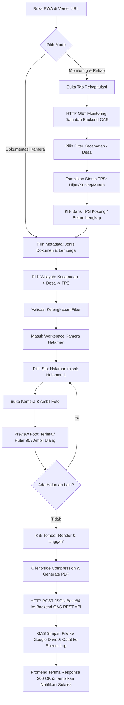

# User Flow (Alur Penggunaan)

### Langkah Interaksi Detail:
1. **Inisialisasi:** Petugas membuka aplikasi PWA via browser/domain Vercel (dapat diinstall ke Homescreen HP).
2. **Pengambilan Master Data:**
   - Frontend mengirimkan request `HTTP GET ?action=getMasterData` ke URL Web App Google Apps Script.
   - Mengisi dropdown Jenis Dokumen, Lembaga, dan hierarki Kecamatan -> Desa -> TPS.
3. **Seleksi Wilayah & Lembaga:**
   - Memilih Jenis Dokumen -> Memilih Lembaga.
   - Memilih Kecamatan -> Dropdown Desa memuat desa di kecamatan tersebut.
   - Memilih Desa -> Dropdown TPS memuat daftar TPS di desa tersebut.
4. **Capture Halaman:**
   - Sistem menampilkan tombol kisi slot `Halaman 1` s/d `Halaman 20`.
   - Petugas menekan slot halaman yang ingin diambil, kamera aktif, foto diambil dan disimpan di memory browser/IndexedDB.
   - Slot halaman berubah warna hijau (terisi).
5. **Finalisasi & Render:**
   - Petugas menekan tombol `Render & Simpan PDF`.
   - Engine client-side (jsPDF) menggabungkan semua halaman menjadi satu dokumen PDF dengan watermark stempel wilayah.
   - Frontend mengirimkan data payload via `fetch(GAS_URL, { method: 'POST', body: JSON.stringify(...) })`.
6. **Monitoring & Deteksi Wilayah Pending:**
   - Petugas/Admin membuka menu Rekap untuk melihat rekapitulasi real-time TPS mana saja yang belum mengirim berkas.
